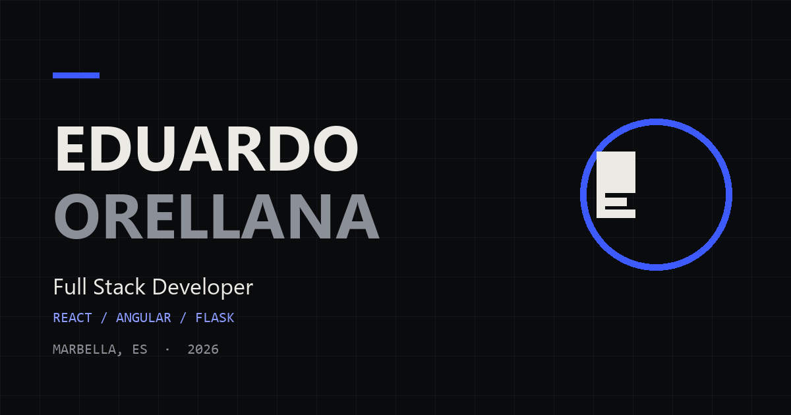

# Portfolio — Eduardo Orellana Pomares

Portfolio personal bilingüe (ES/EN) de un desarrollador Full Stack en Marbella.
Construido con Angular 22, Tailwind CSS 4 y GSAP, con prerender estático y despliegue en Vercel.

**Demo:** https://eduardoorellana.vercel.app



## Qué hay dentro

- **Home** con hero, trabajo seleccionado, otros trabajos, trayectoria, stack, sobre mí y contacto.
- **Dos casos de estudio:** La Nueva Era (TFG con Flask + React) y este mismo portfolio.
- **Español e inglés** completos, en rutas propias y prerenderizadas.
- **Tema claro y oscuro** con preferencia del sistema y toggle persistente.
- **Formulario de contacto** con validación en cliente, honeypot, rate limit y entrega vía Web3Forms desde una función serverless.
- **Privacidad y aviso legal** en los dos idiomas.

## Stack

| Capa | Tecnología |
|---|---|
| Framework | Angular 22 standalone, signals, zoneless, `outputMode: "static"` |
| Estilos | Tailwind CSS 4 con tokens CSS-first |
| Animación | GSAP 3 + ScrollTrigger, carga diferida |
| Tipografía | Archivo Variable, Inter Variable y JetBrains Mono (autoalojadas) |
| Formulario | Vercel Function (`api/contact.ts`) → Web3Forms |
| Tests | Vitest (unidad) y Playwright (E2E) |
| Hosting | Vercel, plan gratuito |

## Comandos

```bash
npm install          # dependencias
npm start            # dev en http://localhost:4200
npm run build        # build + prerender en dist/portfolio/browser
npm run test         # tests unitarios
npm run test:e2e     # smoke tests con Playwright (build + servidor estático)
```

## Estructura

```text
src/app/
├─ content/      # SiteContent tipado: types.ts, es.ts, en.ts
├─ core/         # idioma, tema, SEO, guardas, GSAP
├─ layout/       # cabecera y pie
├─ pages/        # home, caso de estudio, legal, 404
└─ shared/       # directivas y componentes de UI
api/contact.ts   # función serverless del formulario
docs/            # brief de contenido, sistema de diseño, constitución
specs/           # especificación, plan y tareas
```

## Decisiones

- **Contenido tipado, no CMS.** Un único modelo `SiteContent` obliga a que ES y EN tengan la misma forma. Si falta una clave, el build falla antes de publicar. Los tests de paridad lo comprueban.
- **Prerender estático.** Cada ruta se genera como HTML en build time; Vercel sirve archivos estáticos y el usuario recibe contenido antes de que arranque JavaScript.
- **GSAP fuera del bundle inicial.** Se importa dinámicamente solo en el navegador y se desactiva con `prefers-reduced-motion`.
- **Sin cookies ni analítica.** Solo se guarda la preferencia de tema en `localStorage`.
- **Contenido verificable.** Las métricas del TFG (18 endpoints, 12 tablas, 10 juegos, 5 categorías) se midieron sobre la API real. No se afirman tests que no existen.

## Variables de entorno

| Variable | Dónde | Para qué |
|---|---|---|
| `WEB3FORMS_ACCESS_KEY` | Vercel (Production y Preview) | Enviar el formulario a Web3Forms |

Copia `.env.example` como `.env.local` para desarrollo. Sin la clave, `/api/contact` responde `500 not_configured`.

## Accesibilidad

Contraste AA, foco visible, navegación completa por teclado, enlace de salto, `aria-live` en el formulario, `aria-expanded` en el menú móvil y respeto a `prefers-reduced-motion`.

## Licencia

El código se publica para consulta y aprendizaje. Los textos, las capturas y la identidad visual del portfolio son de Eduardo Orellana Pomares. Las marcas y capturas de Time At Work, A-Safe Digital y La Nueva Era pertenecen a sus titulares y se muestran con autorización.
